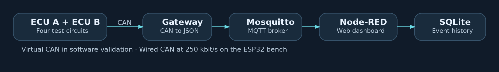
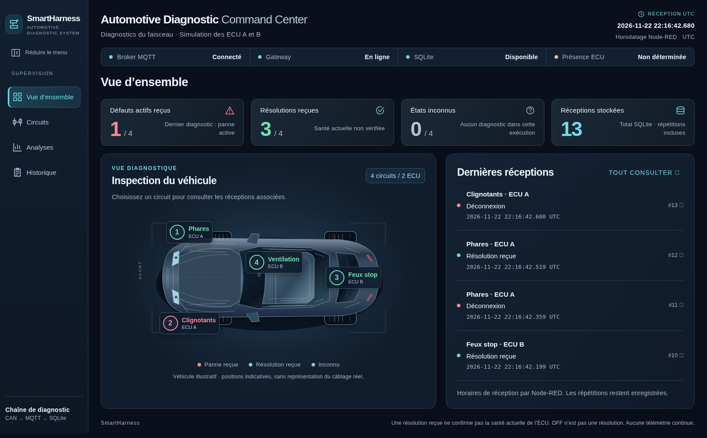
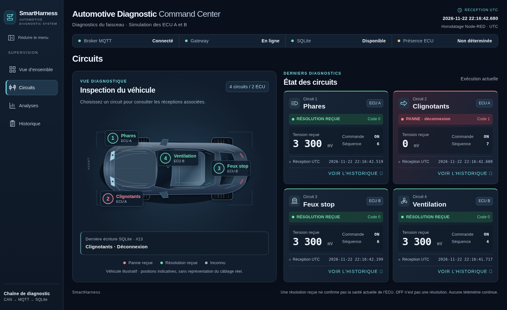
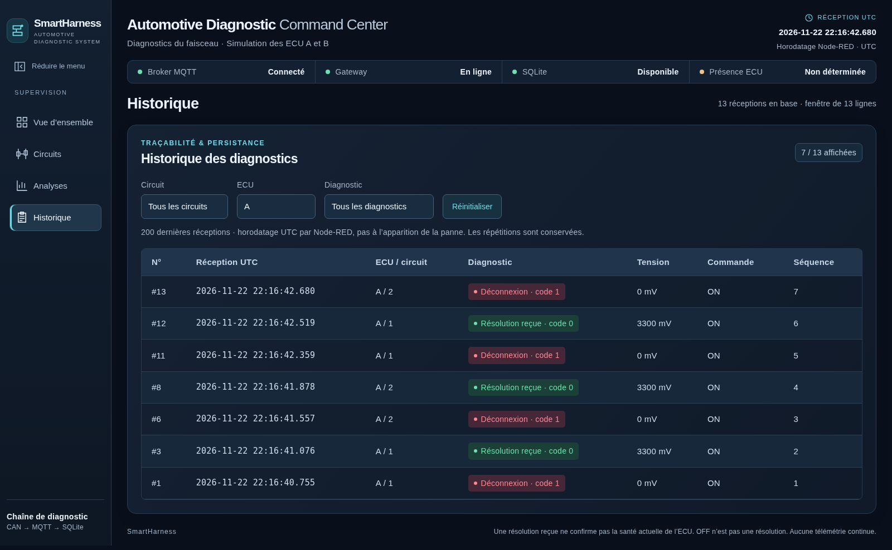

# SmartHarness

SmartHarness is a low-voltage diagnostic bench for automotive-style wiring. Two electronic control units (ECUs) monitor four circuits and report disconnections and recoveries over CAN. A gateway publishes diagnostic events to MQTT. Node-RED displays circuit status and records received events in SQLite.

## Project status

**Current phase · Hardware testing**

The software pipeline has been validated end to end using virtual CAN. The team is now testing the ESP32 bench.

- Check physical circuit sensing and confirm fault and recovery timing.
- Verify communication between the ESP32 nodes on a wired CAN bus at 250 kbit/s.
- Trace bench events through the gateway to the dashboard and verify that they are stored in SQLite.

The ECU firmware currently uses simulated inputs and logs the CAN frames it encodes. Connecting physical inputs and enabling CAN transmission in the ECU application are part of bench integration.

## Architecture



Each ECU detects faults locally. The gateway decodes 8-byte CAN v1 frames and publishes JSON diagnostics over MQTT with QoS 1.

| ECU | Circuit ID | Bench circuit | Fault-event CAN ID |
| --- | ---: | --- | --- |
| A | 1 | Headlights | `0x080` |
| A | 2 | Indicators | `0x080` |
| B | 3 | Brake lights | `0x081` |
| B | 4 | Ventilation | `0x081` |

## Web dashboard

The screenshots show a local virtual CAN run with one reported indicator fault and 13 diagnostic events stored in SQLite. The illustrative vehicle marks the four monitored circuits.



### Circuit details and filtered event history

The circuit view shows the simulated indicator disconnection at 0 mV with the circuit commanded ON.



The history view shows stored disconnection and recovery events filtered to ECU A.



## Run locally

### Virtual CAN simulator

From the repository root, with Python 3.12 in a virtual environment, install the dependencies and run the simulator.

```bash
python -m pip install -r requirements.txt
python -m simulator.main
```

The simulator prints CAN IDs and decoded diagnostics as a circuit on each ECU is disconnected and reconnected.

### Software validation

Install Mosquitto and add it to `PATH` or set `MOSQUITTO_BIN` to the broker executable. Run the Python test suite, simulation scenarios, and network experiments from the repository root.

```bash
python scripts/run_demo.py
```

The validation runner reports skipped tests as incomplete.

### Dashboard and event history

Use Node.js 24 and Mosquitto to run the local Node-RED dashboard with SQLite event history.

## Firmware and bench setup

- ECU application, fault detection, and host-side tests.
- ESP32 gateway build, Wi-Fi configuration, and MQTT forwarding.
- Shared CAN codec, ESP32 TWAI driver, and smoke-test build.

Use an isolated low-voltage bench supply and keep the prototype separate from vehicle wiring and OBD-II systems.

## Project context

Developed for the **IoT & Réseaux** module at **Université Ibn Zohr, Faculté des Sciences d’Agadir**.
