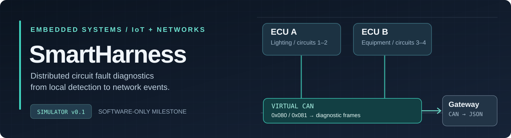
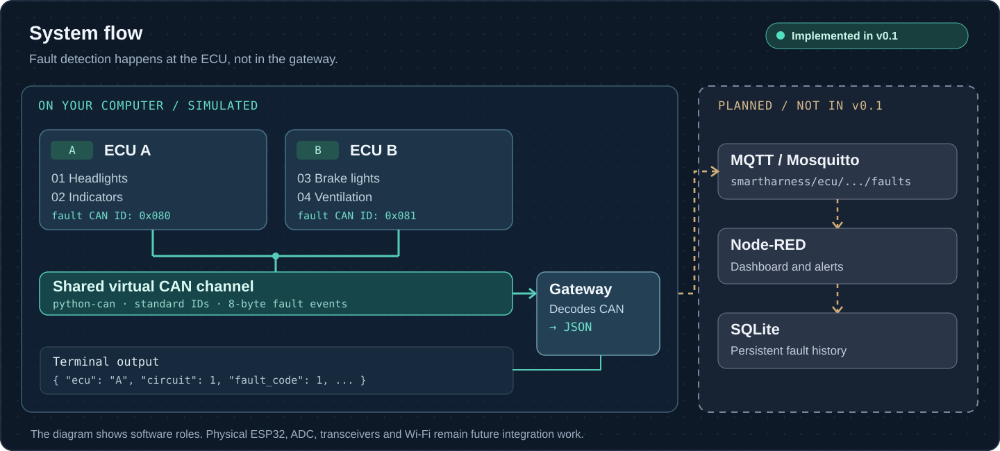

<!-- SmartHarness / software foundation -->

<div align="center">
  
</div>

**SmartHarness** is a low-voltage diagnostic bench inspired by automotive wiring systems. Two independent ECUs monitor four circuits, detect a disconnection locally, and send an event over CAN. A gateway decodes the event so it can be used by a monitoring application.

This repository starts with a **working, software-only reference simulator**. It lets our five-person team agree on the message formats and test the basic data flow before the ESP32 hardware arrives.

Developed for the **IoT & Réseaux** module · **Université Ibn Zohr, Faculté des Sciences d’Agadir**.

## At a glance

| | Simulator v0.1 | Target prototype |
| --- | --- | --- |
| Controllers | Two independent Python ECU objects | Two ESP32 ECUs + ESP32 gateway |
| Circuits | Four simulated voltage readings | Four low-voltage test circuits |
| Fault detection | Disconnection and recovery | Confirmed disconnection + intermittent contact |
| Vehicle-side network | `python-can` virtual bus | Classical CAN, 11-bit IDs, 250 kbit/s |
| Gateway output | Decoded JSON in terminal | CAN → Wi-Fi/MQTT |
| Monitoring | Not implemented | Node-RED + SQLite |

## Architecture



The ECUs make the fault decision. The gateway **does not** infer faults from raw voltage; it translates the ECU's CAN events. This separation is deliberate, so loss of Wi-Fi does not have to stop local detection in the eventual firmware.

### Circuit allocation

| ECU | Circuit ID | Test circuit | Fault-event CAN ID |
| --- | ---: | --- | --- |
| A | 1 | Headlights | `0x080` |
| A | 2 | Indicators | `0x080` |
| B | 3 | Brake lights | `0x081` |
| B | 4 | Ventilation | `0x081` |

## Run the simulator

The first implementation was run on **Windows, Python 3.15.0, `python-can` 4.6.1**. It requires no ESP32, MQTT broker or database.

From the repository root:

```powershell
py -m pip install -r requirements.txt
py -m simulator.main
```

> On Linux or macOS, use your Python interpreter (`python3` instead of `py`).

The demonstration has three steps:

1. All four circuits are commanded ON and initially connected.
2. The headlights (ECU A) and ventilation (ECU B) are disconnected; both generate fault events.
3. Both circuits are reconnected; each ECU reports a resolution event.

**Example from the verified local run:**

```text
=== FAULT INJECTION ===
[CAN] ID: 0x080
[GATEWAY] {"ecu": "A", "circuit": 1, "fault_code": 1, "active": true, "voltage_mv": 0, "command_on": true, "seq": 1}
[CAN] ID: 0x081
[GATEWAY] {"ecu": "B", "circuit": 4, "fault_code": 1, "active": true, "voltage_mv": 0, "command_on": true, "seq": 1}
```

A smaller, single-ECU CAN example is also available:

```powershell
py -m simulator.can_demo
```

### Check the baseline

```powershell
py -m unittest discover -s tests -v
```

The initial smoke test has passed locally. It checks fault events from both ECUs, their CAN IDs, and the gateway decoder. **One smoke test is not comprehensive coverage**; the validation branch will extend this suite.

## How fault detection works

The simulator keeps *commanded state* separate from *measured state*. In the current model, voltage is either **3300 mV** (ON and connected) or **0 mV** (OFF or disconnected).

| Command | Simulated voltage | Interpretation |
| --- | ---: | --- |
| ON | 3300 mV | Normal |
| ON | 0 mV | Disconnection |
| OFF | 0 mV | Intentionally off; no new fault |

`ECU.scan()` checks the circuit only when commanded ON, uses a provisional threshold of **1000 mV**, and emits a diagnostic event when the active fault state changes. It does not repeatedly flood CAN with the same event. A recovery event is produced when the circuit is commanded ON and is measured healthy again.

These are **software-model rules**, not calibrated electrical thresholds. Real ADC acquisition, sampling, filtering and confirmation timing are future work.

## CAN interface

Fault reports use an **8-byte payload**, with multibyte values encoded in little-endian order:

| Byte(s) | Content |
| --- | --- |
| 0 | Circuit ID (`1`–`4`) |
| 1 | Fault code (`0` resolved, `1` disconnection; `2` reserved for intermittent) |
| 2–3 | Voltage in mV (`uint16`) |
| 4 | Flags: bit 0 command ON; bit 1 fault active |
| 5–6 | Event sequence number (`uint16`, per ECU) |
| 7 | Format version (`0x01`) |

For example, `01 01 00 00 03 01 00 01` is a circuit-1 disconnection at 0 mV, with command ON, fault active, and sequence 1.

The authoritative interface specifications are in [`contracts/can_protocol.md`](contracts/can_protocol.md) and [`contracts/mqtt_protocol.md`](contracts/mqtt_protocol.md). The chosen MQTT topic prefix is `smartharness/`; **MQTT publication is not part of v0.1**.

## Project files

```text
SmartHarness/
├── contracts/
│   ├── can_protocol.md        # CAN IDs and fault-event layout
│   └── mqtt_protocol.md       # Future MQTT topics and JSON fields
├── simulator/
│   ├── circuit.py             # Command / connection / voltage model
│   ├── ecu.py                 # Fault state and event generation
│   ├── can_protocol.py        # CAN fault-frame encoder
│   ├── can_demo.py            # Minimal virtual CAN example
│   └── main.py                # Two-ECU end-to-end demo
├── gateway/
│   └── decoder.py             # CAN frame → diagnostic dictionary
├── tests/
│   └── test_smoke.py          # First integration check
├── docs/assets/              # Architecture artwork
├── requirements.txt
├── .gitignore
└── README.md
```

`simulator/` and `gateway/` also contain `__init__.py` package files.

## How the team will build on this

This repository is a **starting point**, not the finished project. The team will use a stable `main`, an integration branch `develop`, and focused feature branches after setup.

| Workstream | Planned branch | Next responsibility |
| --- | --- | --- |
| ECU A + sensors | `feat/ecu-a` | Detection logic, test circuits and ESP32 firmware |
| ECU B + CAN | `feat/ecu-b-can` | Independent ECU firmware and physical CAN network |
| Gateway | `feat/gateway-mqtt` | CAN/MQTT bridge, diagnostic routing and reconnection |
| Dashboard + database | `feat/dashboard-db` | Node-RED views and SQLite event history |
| Simulation + validation | `feat/simulation-tests` | Contract tests, scenarios, regression and measurements |

Before merging, a contribution should **run locally, pass relevant tests, and preserve the shared interfaces**. Changes to CAN fields or MQTT topics require team review, because they affect several workstreams at once.

## Limitations and safety

- v0.1 uses virtual CAN endpoints. It **does not** demonstrate physical CAN arbitration, bus termination, signal quality or communication timing.
- It detects modeled disconnection and recovery only. Intermittent faults, real measurement noise, heartbeat monitoring, diagnostic requests and resilience tests are not implemented.
- There is no working ESP32 firmware, Wi-Fi transport, MQTT publication, dashboard or database yet.
- The planned hardware is a **low-voltage educational bench**. It must not be connected directly to a real 12 V vehicle harness or OBD-II system.

**Engineering rule:** we label a feature as implemented only when it can be run and verified. Everything else stays on the roadmap.

## Gateway & MQTT - partie 3

Le bridge Python et le firmware ESP32 sont dans la branche `feat/gateway-mqtt`.
Guide complet : [partie 3](docs/partie3-gateway-mqtt.md).

```powershell
py -3.12 -m venv .venv-gateway
.\.venv-gateway\Scripts\python.exe -m pip install -r requirements.txt
# Terminal 1
& 'C:\Program Files\Mosquitto\mosquitto.exe' -c broker/mosquitto.conf -v
# Terminal 2
& 'C:\Program Files\Mosquitto\mosquitto_sub.exe' -t 'smartharness/#' -q 1 -v
# Terminal 3
.\.venv-gateway\Scripts\python.exe -m simulator.mqtt_demo
```

Cette demo envoie quatre pannes puis quatre recuperations via CAN virtuel et MQTT reel.
Le CAN virtuel python-can fonctionne dans un seul processus. Le guide precise les
limites de livraison, la configuration ESP32 et les tests. Node-RED et SQLite restent
la responsabilite de la partie 4. Les descriptions v0.1 ci-dessus restent historiques.
